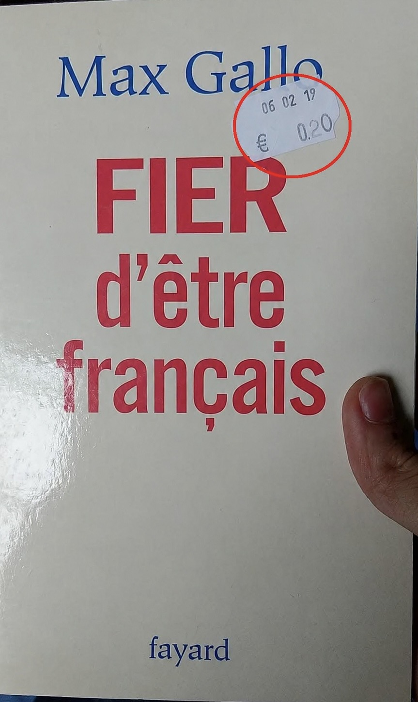

# 欢迎/歡迎/Welcome/<wbr>Välkommen/<wbr>ようこそ

## About Me

I am a vibe mathematician<strong>vibe mathematician</strong>A mathematician who uses AI instead of the human brain to do mathematics.<a class="section-jump" href="#vibe-math" aria-label="Jump to Vibe math" title="Jump to Vibe math">↓</a> at the <a href="https://en.igp.ustc.edu.cn/main.htm">Institute of Geometry and Physics</a> in <a href="https://en.wikipedia.org/wiki/Hefei">Hefei</a>. 主业是乳法。

- In 2022, I obtained my PhD degree at <a href="https://www.chalmers.se/sv/Sidor/default.aspx">Chalmers Tekniska Högskola</a> in Sweden<strong>Sweden</strong>A Scandinavian country. It is not Switzerland. under the supervision of Robert Berman.

- Afterwards, I was a <a href="https://kaw.wallenberg.org/en/mingchen-xia">Wallenberg postdoc</a> from 2022 to 2025. In 2023 and 2024 I applied for the <a href="https://www.cnrs.fr/fr/actualite/le-cnrs-lance-avec-mistral-ai-un-outil-dia-generative-securise-mis-disposition-de-ses">CNRS</a><strong>CNRS</strong>An outdated French research institution that prohibits the use of any AI that is actually useful. position twice without getting a single interview.


Email: <xiamingchen2008@gmail.com> 

> I'm physically in China now, so I do not always have access to gmail, sorry for possibly delayed replies.



  <blockquote>
    
Good to know before contacting me: 1. À quelques exceptions près, je refuse de contribuer<strong>contribuer</strong>En tant que    rapporteur et auteur aux revues françaises. 2. My given name is Mingchen instead of Xia, Xiam, Mincheng, Minchen or Mingcheng. And I am male. 3. Preferred languages: Chinese > English or French. Ich versuche, mein Deutsch zu verbessern. Du kannst mir gern auf Hochdeutsch schreiben, wenn es dich nicht stört, Antworten auf holprigem Deutsch zu bekommen.

  </blockquote>
  



[Where I stand on AI and mathematics](ai-and-mathematics.html)


I am interested in <a href="https://github.com/MingchenXia?tab=repositories">vibe coding</a> and Lean4 for the moment. I am working on formalising papers in complex geometry and pluripotential theory with Lean4.


<section class="content-section content-section--lecture" aria-labelledby="lecture-notes" markdown="1">

## Lecture notes

> Fere libenter homines id quod volunt credunt.

### Archimedean pluripotential theory

- Lectures on pluripotential theory [1](Lectures/ShanghaiTech1.pdf), [2](Lectures/ShanghaiTech2.pdf), [3](Lectures/ShanghaiTech3.pdf), [4](Lectures/ShanghaiTech4.pdf).

> Lecture notes for my course at Shanghai Tech university in the summer of 2023.

- [Characterizations of I-good singularities](Lectures/CAS1.pdf).

> Lecture notes for my course at Chinese academy of science in the summer of 2023.

- [Singularities in global pluripotential theory](Lectures/SGPT_final.pdf) ([source code](https://github.com/MingchenXia/SGPT), [Lean formalization](https://github.com/MingchenXia/SGPT-lean)). Accepted by Springer's LNM series in May 2026.

> Lecture notes for my course at Zhejiang university in the spring of 2024.
>
> À un mathématicien français : Il y a plus d’une façon d’écrire les mathématiques. Si mon livre ne vous plaît pas, vous pouvez tout simplement arrêter de le lire, au lieu de continuer à faire des commentaires absurdes.

### Non-Archimedean geometry

- Lectures on non-Archimedean pluripotential theory [1](Lectures/USTC_NA_1.pdf), [2](Lectures/USTC_NA_2.pdf), [3](Lectures/USTC_NA_3.pdf), [4](Lectures/USTC_NA_4.pdf).

> Lecture notes for my course at USTC in the spring of 2024.

### Complex geometry

- [Lectures on complex geometry](Lectures/CG.pdf) and [Sample papers](Lectures/CG_papers.pdf) for the final presentation.

> Lecture notes for my course at USTC in the fall of 2026.

</section>

## Beamers

- [Pluripotential-theoretic approach to radial energy functionals](Beamers/PTA.pdf)  Beijing university, 11/20/2020 (mm/dd/yyyy).

- [Analytic Bertini theorem](Beamers/ABT.pdf) Oslo SCV conference, 12/18/2021.

- [A mathematician’s complaint about Hermitian operators](Beamers/MC.pdf) A talk for physicists during an informal seminar, 12/10/2021.

- [The volume of pseudo-effective line bundles and partial Okounkov bodies](Beamers/VPPO.pdf)  YMSC Tsinghua university, 12/20/2021.

- [Chern--Weil formulae of singular Hermitian vector bundles](Beamers/CWF.pdf) Aarhus, 05/20/2022.

- [Les singularités $\mathcal{I}$-bonnes --- L'intersection entre la théorie analytique et la théorie algébrique](Beamers/IBS.pdf) IMJ-PRG, 01/03/2023.

> En attendant le remboursement du repa de 7 euros jusqu'à aujourd'hui.

- [A transcendental approach to non-Archimedean metrics](Beamers/TAnA.pdf) Göteborg, 05/04/2023.

- [Transcendental Okounkov bodies and the trace operator of currents](Beamers/TOB.pdf) Toulouse, 10/05/2023.

- [Singularities in global pluripotential theory](Beamers/SGPT.pdf) Kanazawa, 12/06/2023.

- [Partial Okounkov bodies and toric geometry](Beamers/POB.pdf) Cambridge, 05/17/2024.

- [A brief history of potential theory — From Poisson to Lelong](Beamers/HPT.pdf) Shanghai, 09/04/2024

- [Transcendental b-divisors](Beamers/TBD.pdf) Göteborg, 05/28/2025.

- [Zero-mass conjecture --- AI-assisted counterexample](Beamers/ZMC.pdf) Harbin, 08/14/2026.

- [A solution to the Collins--Tosatti conjecture](Beamers/CT.pdf) Shanghai, 11/08/2026.

<section class="content-section content-section--research" aria-labelledby="research" markdown="1">

## Research

>Errare humanum est.

All my preprints can be found on arXiv. See [my Google Scholar page](https://scholar.google.se/citations?user=1GbYhEMAAAAJ) as well. All my mathematical works starting from July 2026 rely on AI.

<nav class="research-tags" aria-label="Research sections">
  <a href="#vibe-math">Vibe math</a>
  <a href="#works-in-progress">Works in progress</a>
  <a href="#k-stability">K-stability</a>
  <a href="#pluripotential-theory">Pluripotential theory</a>
  <a href="#non-archimedean-geometry-and-algebraic-geometry">Non-Archimedean geometry</a>
</nav>

### Vibe math

The articles in this section are generated by AI. I have not carefully verified every detail.

- [Periodic data in degenerating families and skew products](Papers/F01_vibe.pdf)

  > **Abstract.** A degenerating cubic family has one divergent fixed-point multiplier and three bounded ones, so it violates both alternatives of Favre's multiplier dichotomy as stated for every period. We also construct a polynomial skew product with a critical two-cycle whose one-step degree ratio is nonintegral and whose return ratio is integral. Every point in its invariant set over $\mathbb{C}((z))$ is rigid of multiplicity dividing four, and multiplicity four occurs. The proof confines all even-step preimages of zero in a rescaled coordinate to one quartic Puiseux field.

- [Non-Archimedean pluripotential theory over a trivially valued field](Papers/NAPT_vibe.pdf)

  > **Abstract.** A research monograph. 768 pages. Updated November 25, 2026.

- [Math book template](https://github.com/MingchenXia/math-book-template)

- <a href="https://mingchenxia.github.io/Pome/">Pome</a> ([source code](https://github.com/MingchenXia/Pome))

  > A Stacks Project for pluripotential theory. Continuously being written and expanded. The name Pome comes from Prometheus. Contributions to the project via pull requests are welcome.

- [Limits of Higher Cohomology of Line Bundles](Papers/HC_vibe.pdf)

  > **Abstract.** Let $X$ be a smooth complex projective variety of pure dimension $n$ and let $L$ be a line bundle on $X$. We prove that $k^{-n}h^j(X,L^{\otimes k})$ has a finite limit for every cohomological degree $j$. A bound in terms of regularity, support dimension, and sections at a fixed twist controls Frobenius direct images on an arithmetic model. This gives a comparison between exponents $k$ and $pk$ with an error uniform in the prime $p$. Upper semicontinuity and the prime number theorem yield convergence in characteristic zero.

- [Foundations of pluripotential theory](Papers/FPT_vibe.pdf) ([source code](https://github.com/MingchenXia/foundations-of-pluripotential-theory))

  > **Abstract.** A textbook dedicated to Charles Favre. 949 pages. Updated November 24, 2026.

- [Singularities in Hermitian pluripotential theory](Papers/SHPT_vibe.pdf)

  > **Abstract.** A research monograph. 1718 pages. Updated October 13, 2026.

- [Generic Nonuniqueness for Subcritical Positive Kähler–Einstein Dirichlet Problems](Papers/Non_uniq_Dir_vibe.pdf)

  > **Abstract.** Let $X = \mathbb{C}^3 / \{\pm 1\}$ with its isolated klt point $p$, and let $m$ be the natural adapted measure on $X$. We exhibit a nonempty open set of smoothly bounded Stein neighborhoods $\Omega$ of $p$ on which the normalized positive Kähler--Einstein Dirichlet problem admits two distinct bounded solutions for one and the same exponent $\gamma$, which is strictly smaller than the Moser--Trudinger critical exponent of $(\Omega,p)$. The domains are obtained by joining three balls by thin necks, the two solutions are produced by a Leray--Schauder degree argument, and a uniform Moser--Trudinger inequality keeps the exponent subcritical on the whole family. Consequently uniqueness cannot hold for generic Stein neighborhoods of $p$ in the $C^\infty$ topology on domains, even after imposing countably many prescribed transversality conditions on the boundary.

- [A Counterexample to the Global Kähler–Current Conjecture for Weak Kähler–Ricci Flows](Papers/GKC_vibe.pdf)

  > **Abstract.** We disprove the global Kähler-current part of the higher-dimensional geometric-smoothing conjecture formulated by Di Nezza, Guedj, and Lu. We construct a compact Kähler surface and singular initial datum for which the maximal weak fixed-background Kähler–Ricci flow fails to dominate any positive multiple of the background form at every time in a genuine Arnold-multiplicity jumping interval. The surface is the blow-up of the projective plane at one point, and the initial current is purely divisorial with unequal weights. An exact formula for the flow reduces the obstruction to a positive current with zero Lelong numbers in a nef and big class of degree zero on the exceptional curve.

- [Errata to Guedj--Zeriahi's book *Degenerate Complex Monge–Ampère Equations*](Papers/Errata_GZ_vibe.pdf)

- [Errata to Demailly's book *Complex Analytic and Differential Geometry*](Papers/Errata_Demailly_vibe.pdf) ([annotated version with errata](Papers/Demailly_CADG_annotated.pdf))

  > The annotated version should be downloaded and opened locally in a PDF reader that supports annotations.

### Works in progress

- **Transcendental Nakamaye theorem**

> **Abstract.** Let $X$ be a compact Kähler manifold and let $\alpha$ be a pseudoeffective real $(1,1)$-class. We prove that every positive-dimensional irreducible component $V$ of the non-Kähler locus of $\alpha$ has vanishing numerical restricted volume: $\langle\alpha^{\dim V}\rangle_{X\mid V}=0$. Consequently, the non-Kähler locus of $\alpha$ agrees with the null locus defined by numerical restricted volumes.

> Available upon request.

### K-stability

- On sharp lower bounds for Calabi type functionals and destabilizing properties of gradient flows, ***Analysis & PDE*** (2021). [arXiv:1901.07889](https://arxiv.org/abs/1901.07889) [Journal link](https://msp.org/apde/2021/14-6/p12.xhtml)

> My note [Radial Calabi flow](Notes/RCF.pdf) might be of interest to the readers of this paper.

- Pluripotential-theoretic stability thresholds, ***IMRN*** (2022). [arXiv:2012.12039](https://arxiv.org/abs/2012.12039) [Journal link](https://academic.oup.com/imrn/advance-article-abstract/doi/10.1093/imrn/rnac186/6644735)

> In arXiv version 1, Section 8, I briefly explained the second order expansion of Donaldson's L-functionals, which might be of interest as well.

### Pluripotential theory

- Integration by parts formula for non-pluripolar product.  [arXiv:1907.06359](https://arxiv.org/abs/1907.06359)

> This paper was the first proof of the integration by parts formula. However, a better approach was found later on by Lu, so this paper is no longer important. I don't intend to submit it.

- Mabuchi geometry of big cohomology classes, ***Journal für die reine und angewandte Mathematik*** (2023). [arXiv:1907.07234](https://arxiv.org/abs/1907.07234) [Journal link](https://www.degruyter.com/document/doi/10.1515/crelle-2023-0019/html)

>  There is a slight issue in the proof of Theorem 2.11 line 10:  $f^{\sharp}$ is only formally smooth, not smooth.  This does not affect anything in the proof. This is corrected in [this version](Papers/MG.pdf).

> As pointed out by Vasanth Pidaparthy and Prakhar Gupta, the statement of Proposition 4.12(ii) (Proposition 6.12(ii) in the arXiv version) is wrong in the generality as stated there,  one needs to assume that $\varphi_0\leq \gamma\leq \varphi_1$ in addition. This mistake does not affect the other parts of the paper.

> The published version contains only the special case without prescribed singularities on Kähler manifolds. The method in the general case is exactly the same.

- The closures of test configurations and algebraic singularity types, (joint with Tamás Darvas), ***Advances in Mathematics*** (2022). [arXiv:2003.04818](https://arxiv.org/abs/2003.04818) [Journal link](https://www.sciencedirect.com/science/article/pii/S0001870822000147)

- The volume of pseudoeffective line bundles and partial equilibrium, (joint with Tamás Darvas), ***Geometry & Topology*** (2024). [arXiv:2112.03827](https://arxiv.org/abs/2112.03827) [Journal link](https://msp.org/gt/2024/28-4/p09.xhtml)

- Partial Okounkov bodies and Duistermaat--Heckman measures of non-Archimedean metrics, ***Geometry & Topology*** (2025). [arXiv:2112.04290](https://arxiv.org/abs/2112.04290) [Journal link](https://doi.org/10.2140/gt.2025.29.1283)

> The proof of the Hausdorff convergence property in this paper is quite messy. My [book](Lectures/SGPT2.pdf) contains a more readable proof.

- Non-pluripolar products on vector bundles and Chern--Weil formulae, ***Mathematische Annalen*** (2024). [arXiv:2210.15342](https://arxiv.org/abs/2210.15342) [Journal link](https://link.springer.com/article/10.1007/s00208-024-02838-4)

- Transcendental Okounkov bodies, (joint with Tamás Darvas, Rémi Reboulet, David Witt Nyström and Kewei Zhang), ***Journal of Differential Geometry*** (2026). [arXiv:2309.07584](https://arxiv.org/abs/2309.07584) [Journal link](https://doi.org/10.4310/jdg/1766433802)

- The trace operator of quasi-plurisubharmonic functions on compact Kähler manifolds, (joint with Tamás Darvas), ***Transactions of the American Mathematical Society*** (2026). [arXiv:2403.08259](https://arxiv.org/abs/2403.08259) [Journal link](https://doi.org/10.1090/tran/9785)

- A counterexample to the zero-mass conjecture, (joint with Long Li). [arXiv:2607.26549](https://arxiv.org/abs/2607.26549)

- A counterexample to the bounded mass property, (joint with Kewei Zhang). [arXiv:2608.21053](https://arxiv.org/abs/2608.21053)

### Non-Archimedean geometry and algebraic geometry

- [Mixed volumes of Okounkov bodies](Papers/MVOB.pdf)

> Updated in July 2026. I proved the mixed volume formula of Okounkov bodies and partial Okounkov bodies.

- [Transcendental b-divisors](Papers/TB.pdf)

> Updated in December 2025.

- [Transcendental b-divisors II](Papers/TB2.pdf)

> Updated in July 2026. The optimal constant in Corollary 6.17 is obtained.

- The envelope property for unibranch projective varieties, (joint with Yanbo Fang and Jiyuan Han). [arXiv:2611.26301](https://arxiv.org/abs/2611.26301)

- On Liu morphisms in non-Archimedean geometry, ***Israel Journal of Mathematics*** (2022). [arXiv:2106.08032](https://arxiv.org/abs/2106.08032) [Journal link](https://link.springer.com/article/10.1007/s11856-022-2456-6)

> In the complex analytic setting, very similar arguments (using Fréchet algebras instead of Banach algebras) give the notion of Stein morphisms. It is of interest to see if these morphisms are useful.  M. Maculan pointed out that Liu morphisms are not G-local on the target, see the [corrected version](Papers/Liu.pdf).  I will update arXiv in a few days.

- Analytic Bertini theorem, ***Mathematische Zeitschrift*** (2022). [arXiv:2110.14971](https://arxiv.org/abs/2110.14971) [Journal link](https://link.springer.com/article/10.1007/s00209-022-03103-7)

>  There is minor gap in the proof:  In the first step, one needs to further enlarge $\Sigma_1$ to make sure that the restriction ideal coincides with the pull-back as coherent sheaves. A corrected proof is presented in my lecture notes at Zhejiang University. 

- Analytic Bertini theorem II --- The local case. [arXiv:2607.25230](https://arxiv.org/abs/2607.25230)

- A transcendental approach to non-Archimedean metrics of pseudoeffective classes, (joint with Tamás Darvas and Kewei Zhang), ***Commentarii Mathematici Helvetici*** (2025). [arXiv:2302.02541](https://arxiv.org/abs/2302.02541) [Journal link](https://doi.org/10.4171/CMH/586)

> The theory of non-Archimedean psh functions we developed in this paper trivally satisfies Boucksom--Jonsson's envelope conjecture (even on a general unibranch complex space), see my note [Operations on transcendental non-Archimedean metrics](Notes/OTNA.pdf).

</section>

<section class="content-section content-section--notes" aria-labelledby="some-notes" markdown="1">

## Some notes

- [LaTeX tips for working mathematicians](Notes/LaTeX_tips.pdf)

- [Relative pluripotential theory](Notes/RPT.pdf) (Chapter I to Chapter III)

> Just a preliminary version with potentially many mistakes. I'm slowly adding new materials.

- [Operations on transcendental non-Archimedean metrics](https://bookstore.ams.org/view?ProductCode=CONM/810). [arXiv:2312.17150](https://arxiv.org/abs/2312.17150).

> This note is a trivial continuation of my joint paper with Darvas and Zhang. The only notable result is Theorem 4.21.  The editors put an earlier version in the final book by mistake. Please read the arXiv version instead. 

- [Stein spaces](Notes/SS.pdf)

> **Abstract.** A textbook. 293 pages. Updated November 25, 2026.

- [Schemata über Steinschen Algebren](LaTeX/Bingener.pdf)

> I turn Bingener's famous 1976 paper in to LaTeX format. 

</section>

## My favourite links

### Legal links

- [Online math seminars](https://researchseminars.org)

- [Tikz-cd editor](https://tikzcd.yichuanshen.de)

- [Quiver](https://q.uiver.app)

- [Stacks Project](https://stacks.math.columbia.edu)

- [Kerodon](https://kerodon.net)

- [Almost Sure](https://almostsuremath.com)

- [MacTutor](https://mathshistory.st-andrews.ac.uk)

### Illegal links

- [ZLibrary](https://z-library.sk)

> Updated on Nov 8, 2024.

- [Libgen](https://libgen.vg)

> Updated on Jul 21, 2025.

- [Sci-hub](http://sci-hub.vkif.top)

> Sci-hub is getting blocked in many countries recently. If the link fails to work, please try to change the domain name.
